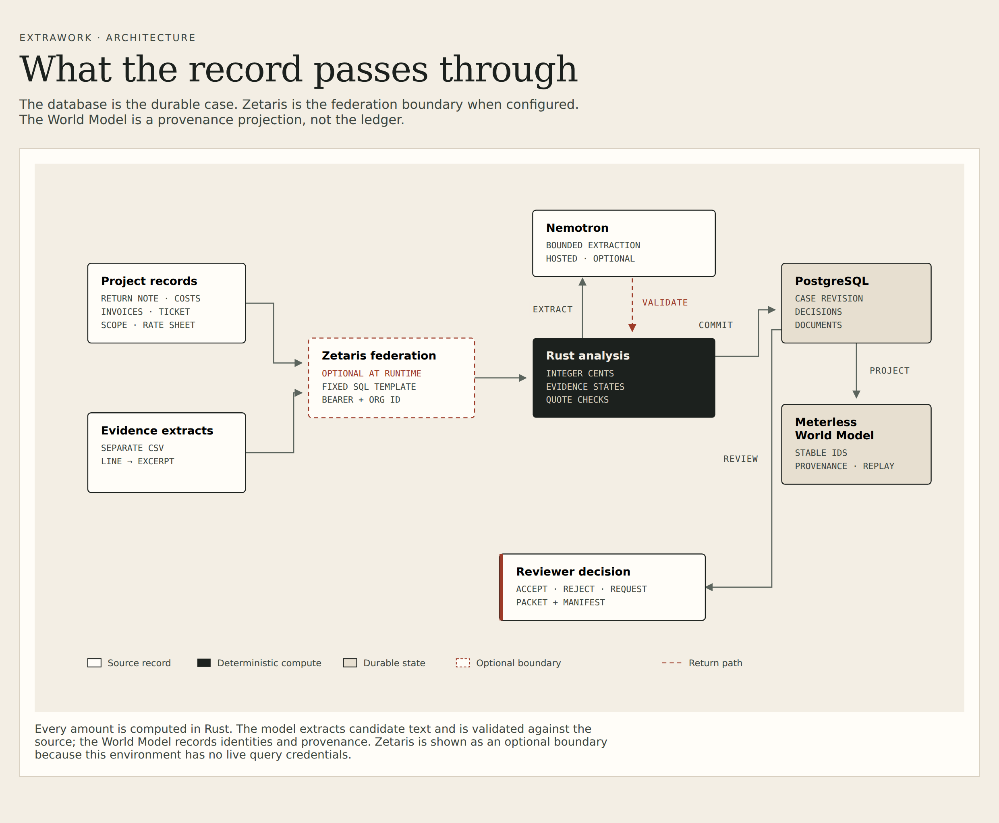

# ExtraWork

**Repair the request. Show the record.**

ExtraWork is an agentic evidence workspace for one costly, recurring moment: a specialty
contractor's request for extra work comes back rejected, and someone has to reconstruct what the
records actually support before resubmitting it.

Two synthetic project files ship in the app:

- `COR-184` (Harbor Annex) has a scissor lift billed twice, no written approval of a $150 overtime
  rate, and an unconfirmed scope position.
- `CHG-207` (Northgate Plant) has a valve package short-shipped by two units, no signed ticket for a
  Saturday crew, and a crane rental outside the base scope.

ExtraWork resolves what the records support, separates work evidence from price authority, keeps the
unanswered objection visible, and prepares a review packet that a person still has to sign off on.
The second case exists to prove the rules are not a single fixture: it adds a quantity shortfall and a
deliberate refusal.

It is deliberately **not** a claims chatbot, a change-order dashboard, or an "AI will get you paid"
product. It prepares a request for contractor review. It does not authorize billing.

> **Synthetic demo:** every record in both shipped cases is fabricated and labelled as such. No money
> was recovered, no claim was approved, and no invoice was submitted.

## Demo video

[](https://github.com/PhiBao/extrawork-agent/releases/tag/demo-v1)

**1:54 · narrated · 1080p.** [Watch the demo on GitHub Releases](https://github.com/PhiBao/extrawork-agent/releases/tag/demo-v1).
The caption track is included as `extrawork-demo.srt` in the same release.

---

## Why this product

### The user

The owner or office manager of a small specialty contractor (electrical, mechanical, concrete,
glazing) who handles commercial change orders themselves or with a bookkeeper.

### The problem

Change-order software is good at capturing work **as it happens**. The expensive failure in a small
shop is different: the work has already happened, the request has already been sent, and it has come
back with objections. Now someone has to open a folder of tickets, invoices, emails, and contract
excerpts and work out:

- Which objection is actually resolved by a record?
- Which number in the request is wrong?
- Which sentence merely proves someone was on site, and which one proves a price was agreed?
- What is still missing, and what should be asked for instead of guessed?

The usual workaround is an evening with a spreadsheet and a search across an inbox. The risk is not
just lost money; it is sending a second, weaker request that overstates the case.

### The value

ExtraWork returns a **defensible revision**, not a persuasive narrative:

- a supported total built from explicit corrections;
- an evidence state per assertion (`supported`, `missing`, `contradicted`, `ambiguous`);
- a reservation wherever the record proves less than the request implies;
- a specific repair task for what is missing;
- an exportable packet with citations and document hashes.

### Why now

Two changes make this practical without a large integration project:

1. Document models are now good enough to extract candidate facts from messy correspondence and
   invoices, **provided** the product validates quotes and keeps arithmetic deterministic.
2. Federated query layers such as Zetaris let a small product join operational records without first
   copying a contractor's ERP into a warehouse.

The hard part is no longer reading the document. It is refusing to let a fluent reading become a
financial claim.

### Product insight

**The valuable unit is not a change order. It is a repaired objection.**

A contractor does not need another place to store a COR. They need to know which sentence in a
returned request is answered by which record, and which part of the number no longer holds. That
framing produces a much smaller, more honest, and more useful product than "AI for construction
claims".

---

## The experience

### Primary workflow

1. Open the returned request. ExtraWork shows the objections exactly as the counterparty wrote them.
2. Read the repair sheet. Each objection has findings, citations, and a state.
3. Decide on a proposed correction (remove the duplicate, or keep both lines).
4. Add a missing record (for example, written approval of a rate).
5. Watch only the affected finding change. The amount never moves by itself.
6. Export the review packet and the evidence manifest.

### Activation moment

The user sees that **the duplicate is real and the invoice proves it**, and that the signed field
ticket does *not* prove the overtime rate. The product distinguishes two things that looked identical
in the folder: work happened, and a price was agreed.

### Deliberate interactions

- **Objection-indexed repair**, not a chat. The left rail is the counterparty's own sentences.
- **Source-first inspection.** Selecting an objection loads the actual document and highlights the
  quoted sentence.
- **Amounts change only through a recorded human decision.**
- **Reservations are permanent.** A packet can be exported with an unresolved rate; it cannot pretend
  the rate was approved.
- **New evidence changes the answer.** Upload `fixtures/harbor-annex/rate-approval.eml` and the
  overtime objection moves from `unresolved` to `answered`, while the duplicate correction stays
  exactly where the reviewer left it.

### Differentiation

Clearstory, Datagrid, ClaimMaster, and Document Crunch already read construction documents and
support change-order or claims workflows. ExtraWork does not claim that space is empty, and it does
not try to replace a project-management system.

The narrow bet is the **returned-request repair loop for a small subcontractor using records they
already have**:

| Typical project tool | ExtraWork |
|---|---|
| Capture the change as it happens | Repair the request after it is rejected |
| Requires project-wide adoption | Starts from one returned request and a folder |
| Optimises review routing | Optimises evidence sufficiency and arithmetic |
| Reports a status | Shows a supported total and its reservations |
| "Approved" is a workflow state | Work direction, cost support, price approval, and payment stay separate |

That is a hypothesis to validate with contractors, not a proven market gap.

---

## Innovation

The novelty is in the **repair protocol**, not in using a language model:

- **Objection-level evidence states.** Every conclusion is `supported`, `missing`, `contradicted`, or
  `ambiguous`, and an unanswered objection stays visibly unanswered.
- **Authority separation.** A field ticket can support hours while being explicitly unable to support
  a rate. The product never collapses "work was directed" into "price was approved".
- **Deterministic money.** All totals and deltas are integer cents computed in Rust. A language model
  may propose an extraction; it cannot set a total.
- **Evidence-bound revisions.** Findings carry exact quotes; a quote is accepted only if it exists in
  the named document. Uploading a new record recomputes findings from the whole set.
- **Revision checks.** A reviewer decision carries the expected case revision, so a stale decision
  cannot overwrite newer evidence.
- **A provenance projection.** Findings, documents, and evidence states are projected into the
  Meterless World Model with stable external IDs, so the same case can be replayed without duplicating
  entities or superseding one citation with another.

What it is not: a wrapper that sends a PDF to a model and prints a letter. The differentiator is the
refusal behaviour and the visible state transitions.

---

## Hackathon relevance

- **Event:** Open Agent Hackathon 2026 (October 22–27, 2026).
- **Primary track:** **02 — The Agent That Can Explain Why.**
- **Backup track:** **01 — Solving Fragmented Intelligence.**
- **Sponsor technology:** Zetaris (federation boundary), Meterless (World Model engine), NVIDIA
  Nemotron (validated objection classification, served through Nebius Token Factory).
- **Rubric alignment:** Impact 30 (returned requests and cash), Technical 20 (Rust rules, evidence
  validation, revision state), Innovation 15 (repair protocol and authority separation), Demo 15
  (duplicate removed, rate approval changes the answer), Product & UX 10 (objection-indexed sheet),
  Sponsor tech 10 (working engine plus live federation path).

### Zetaris integration

The client supports the three surfaces Zetaris actually publishes, selected by
`ZETARIS_API_STYLE`:

| Style | Health | Join query |
|---|---|---|
| `gateway` (default) | `GET /api/proxy/lightning-database/databases` | `POST /api/proxy/sql-editor/sqls/run-query` with `{sql, limit}` |
| `rest` | `GET /api/v1.0/datasource/datasources` | `POST /api/v1.0/sql-editor/sqls/run` with `{queryId, sql, source, limit}` |
| `saas` | `GET /api/v1.0/datamart` | `POST /api/v1.0/query/sql/start` with `{select, pageLimit}`, then `DELETE /query/sql/close/{token}` |

The Gateway style is what a managed cluster exposes to coding clients; it accepts an API key or a
username/password login at `/api/auth/login`. If `ZETARIS_API_STYLE` is unset, the style is inferred
from the URL (`api.saas.` → SaaS, `:8888` or a path ending in `/api/v1.0` → REST, otherwise Gateway). The join is a fixed template over two registered tables
(`project_lines`, `evidence_extracts`) with identifier validation. No model writes SQL.

**Current status:** Zetaris is **live and used by the findings** through a local install of the
licensed platform (the same 2.4.3 bundle), because the AWS account is under an account-level load
balancer restriction:

- Local platform: all nine vendor checks pass, including login and a query through UI → API → driver
  → Spark. ExtraWork runs the real join through the Gateway proxy; the proof records
  `joinMode: zetaris_live`, four extracts, and a closed query.
- AWS: the quickstart stack `zetaris-main-9acdd8a3` is `CREATE_COMPLETE`, the callback returned 200,
  and EKS `zetaris-extrawork-8b3246e1` is **ACTIVE** with two nodes. The application phase stopped at
  the AWS Load Balancer Controller: every load-balancer creation returns
  `OperationNotPermittedException — This AWS account currently does not support creating load
  balancers` (including from root, and in `us-east-1`). Target groups and nodes work; only LB creation
  is blocked.

The AWS block and the local setup are documented in [`docs/ZETARIS.md`](docs/ZETARIS.md); the support
case text is in [`docs/AWS-ELB-CASE.md`](docs/AWS-ELB-CASE.md). When the Gateway is unavailable,
ExtraWork falls back to the local PostgreSQL + evidence-CSV join and labels it `local_two_source`.

The verified local setup uses:

```bash
ZETARIS_API_STYLE=gateway
ZETARIS_BASE_URL=http://127.0.0.1:3010
ZETARIS_ORG_ID=1
ZETARIS_USERNAME=admin@extrawork.dev
ZETARIS_PASSWORD=...          # kept in the local .admin-password file
ZETARIS_PROJECT_TABLE=harbor_pg.project_lines
ZETARIS_EVIDENCE_TABLE=harbor_pg.evidence_extracts
```

`scripts/setup-local-zetaris.sh` configures the supplied bundle, starts it on port 3010 (3000 is
commonly occupied), writes the settings into `.env`, and the live join reads the two tables
registered from the local Postgres datasource. All three client paths are also exercised over real
HTTP against a contract mock (`scripts/mock_zetaris.py`); see `scripts/check.sh`. The mock is not
Zetaris and is never presented as live vendor evidence.

### Meterless integration

The app vendors the **actual World Model reference implementation** (Apache-2.0) at commit
`1742dec56a66e58eef9dda2d2b865823758ca8cd` and runs it as a local sidecar. It is not decoration:

- The case, findings, documents, and evidence links are projected on every revision.
- External IDs prevent the reference's fuzzy name resolver from merging two identical-looking cost
  lines.
- Relationship types include the target, so multiple citations remain open instead of superseding
  each other.
- The feature test replays the same projection and asserts the canonical world state is unchanged.
- The upstream conformance suite passes 8/8.

**Requirement check:** a Meterless engine is implemented in a working feature and demonstrated by a
passing test (`meterless-world/src/project.test.ts`) plus the conformance runner.

### NVIDIA integration

Nemotron is used as a **bounded classifier**, not as a source of truth. The server sends the return
note to `nvidia/NVIDIA-Nemotron-3-Nano-30B-A3B` and asks for one exact quote and one topic per
objection. Every returned quote must exist verbatim in the note, and every topic must be one of
`duplicate`, `quantity`, `ticket`, `rate`, `scope`, or `other`. Invalid pairs are rejected and counted.
Accepted topics are persisted and **route the deterministic checks**; amounts still come from Rust.

The current deployment uses **Nebius Token Factory** as the OpenAI-compatible gateway
(`https://api.tokenfactory.nebius.com/v1/chat/completions`) because direct NVIDIA account
verification is restricted. The model itself is NVIDIA Nemotron. A direct NVIDIA key can be used by
changing `NEMOTRON_URL`; the request shape is identical.

The key stays server-side. No key is committed. If the model is unavailable or returns invalid
output, the heuristic classifier runs and the proof says so. The model cannot set a total, approve a
rate, or create an entitlement.

### Cursor

The event now permits any AI coding tool. This build did not have Cursor available in the environment.
The repository documents the stack and process rather than claiming an unverified tool history.

---

## Architecture



The diagram is also available as a self-contained HTML file: `docs/architecture.html`.

### Stack

| Layer | Choice |
|---|---|
| Frontend | React 19, TypeScript, Vite, self-hosted Fraunces and Source Sans 3 |
| Backend | Rust, Axum, Tokio, SQLx |
| Case store | PostgreSQL 16 (Docker locally) |
| Evidence source | Separate CSV file, read independently of the database |
| World model | Meterless World Model reference (TypeScript sidecar, vendored and pinned) |
| Model | NVIDIA Nemotron via Nebius Token Factory (optional), deterministic rules engine always on |
| Federation | Zetaris REST client (optional at runtime) |
| Export | Server-rendered review packet + zip manifest |

### Data flow

1. **Ingest.** Uploads or seeded fixtures are parsed into `Doc` records with a SHA-256 hash and a
   document kind. Duplicate hashes are ignored.
2. **Analyse.** Rust reads the cost export, return note, invoices, ticket, scope, rate sheet, directive,
   prior billing, and evidence extracts. Findings are produced by explicit rules.
3. **Reconcile.** Cost lines are compared against the PostgreSQL project-line table. A disagreement is
   surfaced in `sourceAgreement`; it is not hidden.
4. **Project.** Stable case/finding/document entities and evidence links are sent to the World Model
   sidecar. The result includes event count and replay equality.
5. **Review.** A decision is stored with the finding key and the expected revision.
6. **Export.** The packet includes supported totals, reservations, and a sources manifest.

### Important technical decisions

- **Rust owns money and decisions.** `rust_decimal` is not needed because amounts are parsed into
  integer cents with an explicit two-decimal grammar; hidden fractions are rejected.
- **PostgreSQL is the durable record.** The World Model is a projection for provenance and replay, not
  the ledger.
- **No model-generated SQL.** Zetaris queries come from a validated template.
- **No auto-approval.** `billing_posture` remains `not_authorized`; approval of a rate only changes the
  reservation text.
- **No silent fuzzy merge.** Meterless's resolver is pinned above 1.0 for name matching; all ExtraWork
  identities are externally keyed.
- **Stale writes fail.** Decision requests must match the current revision.

### Repository map

```
server/            Rust domain, HTTP API, extraction, Zetaris client
  src/domain.rs    analysis rules, totals, evidence states, tests
  src/extract.rs   upload parsing and document classification
  src/zetaris.rs   REST client and SQL template validation
  src/main.rs      HTTP routes, persistence, export, projection
web/               React client and visual system
meterless-world/   pinned World Model reference + adapter + feature test
fixtures/          synthetic Harbor Annex and Northgate Plant records
docs/              architecture and repair-state diagrams
scripts/           demo and check scripts
```

---

## Running

### Prerequisites

- Rust toolchain (stable or nightly)
- Node.js 22 and pnpm
- Docker (for PostgreSQL)
- No cloud account is required for the synthetic demo

### Setup

```bash
cp .env.example .env
docker run -d --name extrawork-pg \
  -e POSTGRES_PASSWORD=extrawork -e POSTGRES_USER=extrawork -e POSTGRES_DB=extrawork \
  -p 127.0.0.1:54329:5432 postgres:16-alpine
(cd meterless-world && pnpm install)
(cd web && pnpm install)
```

### Run

```bash
./scripts/demo.sh
```

This starts PostgreSQL, starts the local Zetaris platform if its bundle is present, starts the
Meterless sidecar on `:8091`, builds the web client, runs the Rust server on
`http://127.0.0.1:8081`, and resets both cases to revision 1.

If the Zetaris bundle or Nemotron key is absent, the app still runs: Zetaris falls back to the
separate evidence CSV (`local_two_source`) and objections fall back to the heuristic classifier.
The proof panel says which path ran.

For development, run the sidecar and backend in separate terminals, then `pnpm dev` in `web/`.

### Test

```bash
./scripts/check.sh
```

Runs:

- `cargo test --lib` — 21 domain and client tests, including both cases.
- `pnpm test` in `meterless-world` — the World Model feature and replay assertions.
- `pnpm conformance` — the upstream Meterless suite (8/8).
- `pnpm build` — TypeScript check and production build.
- `scripts/e2e.sh` — resets the case, accepts the duplicate, uploads the rate approval, checks totals,
  exports, stale-revision rejection, unsupported-PDF rejection, and reset.

Two optional verification scripts:

```bash
./scripts/e2e.sh             # against the running app
./scripts/verify-zetaris.sh  # Zetaris Gateway client over HTTP, against the contract mock
```

`verify-zetaris.sh` starts a second app instance on port 8082 with the Gateway style and asserts the
health call, the join, the row count, and the released query. It is a contract test, not vendor
evidence.

### Environment

| Variable | Required | Purpose |
|---|---|---|
| `DATABASE_URL` | yes | PostgreSQL connection |
| `EXTRAWORK_ROOT` | yes in containers | Repository root for fixtures and `web/dist` |
| `EXTRAWORK_BIND` | no | Defaults to `127.0.0.1:8081` |
| `METERLESS_URL` | no | Defaults to `http://127.0.0.1:8091` |
| `ZETARIS_API_STYLE` | no | `gateway` (default), `rest`, or `saas` |
| `ZETARIS_BASE_URL` | no | Enables the live Zetaris path |
| `ZETARIS_API_KEY` | no | Server-side only, or use username/password on Gateway |
| `ZETARIS_USERNAME` / `ZETARIS_PASSWORD` | no | Gateway login alternative to an API key |
| `ZETARIS_ORG_ID` | no | Numeric organisation id (required for REST and SaaS) |
| `ZETARIS_PROJECT_TABLE` | no | Defaults to `project_lines` |
| `ZETARIS_EVIDENCE_TABLE` | no | Defaults to `evidence_extracts` |
| `NEMOTRON_API_KEY` | no | Enables the hosted Nemotron classifier; `NVIDIA_API_KEY` is also accepted |
| `NEMOTRON_URL` | no | Defaults to the Token Factory chat-completions URL; set a direct NVIDIA URL if available |
| `NEMOTRON_MODEL` | no | Defaults to `nvidia/NVIDIA-Nemotron-3-Nano-30B-A3B` |

Never put a Zetaris or Nemotron key in client code. The app reads them server-side only.

---

## Demo

**Open `http://127.0.0.1:8081/`.**

Try this order:

1. Read objection 01. The duplicate is supported by invoice INV-902; the second line is marked
   `duplicate`.
2. Click **Remove the duplicate**. The supported total moves from `$6,800.00` to `$5,800.00`, and the
   row is struck through.
3. Read objection 02. The rate objection stays `unresolved`: the ticket proves hours, not price.
4. Upload `fixtures/harbor-annex/rate-approval.eml` with **Add a record**. The same objection becomes
   `answered`, the finding flips to supported, and the source pane shows the approval sentence.
5. Read objection 03. The exclusion and the direction are both cited; the reservation still says a
   direction is not a price approval.
6. Download **the review packet** and **the record zip**. Both include the reservations and sources.
7. Open **How this was checked** to see the join status, the World Model commit, replay result, and
   the Zetaris query.
8. Switch to **CHG-207 · Northgate Plant**. Accept the two-unit shortfall and watch the line
   adjustment; select the Saturday-crew objection to see the refusal and the next request.

A timed shot list and narration guardrails are in `docs/DEMO.md`. The submission deck is
`docs/deck.html` (printable to PDF from a browser).

### What to look for as a judge

- The amount changes only after a recorded decision.
- Uploading a record changes one finding, not the whole narrative; the **Last change** line names it.
- The app never says the claim was paid or approved.
- The run strip shows the sequence: read, join, check, propose, flag.
- The Zetaris strip shows the live join, row count, and the exact query.
- The World Model shows a real engine commit, event count, and replay equality.

### Resetting

Use **Reset the example** in the app, or `POST /api/cases/harbor-annex/reset` /
`POST /api/cases/northgate-mechanical/reset`. This restores the seeded records, clears decisions, and
resets the evidence CSV for that case.

---

## Verification

| Claim | Status |
|---|---|
| Duplicate, quantity shortfall, rate separation, missing ticket, scope, prior-billing checks | **Implemented and unit-tested on both cases** |
| Supported total, line adjustment, and reservation logic | **Implemented and unit-tested** |
| Evidence quotes exist in their named documents | **Asserted in tests** |
| Prompt injection cannot change the total | **Unit-tested** |
| Meterless World Model engine used in a working feature | **Yes — projection on every revision, verified by test and conformance** |
| World Model replay idempotent for the same projection | **Verified by test** |
| Zetaris client for Gateway, REST, and SaaS surfaces | **Implemented; tested against the published shapes and a local HTTP contract mock** |
| Live Zetaris query | **Yes — local Zetaris 2.4.3 Gateway → driver → registered Postgres datasource; `SELECT 1`, a 4-row Harbor join, and a 5-row Northgate join** |
| Zetaris rows used in the findings | **Yes — `joinMode: zetaris_live`, query closed** |
| Local fallback when Zetaris is down | **Yes — PostgreSQL + separate evidence CSV, labelled `local_two_source`** |
| AWS managed cluster | **Deleted after diagnosis; the account-level ELB restriction remains** |
| AWS ELB block diagnosed | **Yes — `OperationNotPermittedException`, reproduced as root and in `us-east-1`** |
| AWS quickstart registration | **Verified: stack `CREATE_COMPLETE`, callback HTTP 200** |
| Hosted Nemotron classification | **Yes — all objections in both cases classified by Nemotron; exact quote/topic validation; topics route the checks** |
| Invalid model output handling | **Rejected quote/topic pairs counted; heuristic fallback** |
| Money recovered / claim approved / invoice sent | **No — explicitly out of scope** |
| Cursor use | **Not verified; not claimed** |

### Synthetic versus real

- **Synthetic:** all Harbor Annex and Northgate Plant documents, cost lines, approvals, and return
  notes.
- **Real:** the Rust analysis, the PostgreSQL records, the file parsing, the World Model sidecar and
  its conformance, the Zetaris Gateway query, the HTTP API, the exports, the browser UI.
- **Live external services:** local Zetaris 2.4.3 and Nebius Token Factory (NVIDIA Nemotron).

### Real-case effort

Outreach to specialty contractors and construction bookkeepers is in progress; **no permissioned,
redacted returned request has arrived yet** as of October 23, 2026. Both shipped cases therefore
remain synthetic and are labelled in the UI. A public-records search found denial decisions and
audits, but not a complete request + return note + backup package that could be used honestly.

If a real record arrives, it will replace Northgate and this note will be updated. We will not relabel
a reconstructed, composite, or public-record adaptation as customer data.

---

## Security and reliability

### Boundaries

- **Single local tenant.** This is a demo build; there is no production identity provider. The server
  binds to loopback and must not be exposed publicly as-is.
- **Server-side secrets.** Zetaris, Nemotron, and gateway keys are read from the environment and
  never sent to the browser.
- **Fixed SQL template.** Table identifiers are validated against a strict grammar and the case id is
  restricted to alphanumerics and hyphens; a model cannot author SQL.
- **Upload limits.** 5 MB per file, extension allowlist, UTF-8 or uncompressed PDF text only, bounded
  parsing. Compressed PDFs are rejected with a clear message rather than guessed at.
- **Output escaping.** The exported HTML escapes all record text.
- **Revision checks.** Decisions carry an expected revision; stale decisions return `409`.
- **Untrusted documents.** A document can contain instructions; the analyzer ignores them. Content is
  data, never a command.
- **No autonomous external action.** Nothing is emailed, filed, signed, or billed.

### Known risks

- Demo authentication is absent by design; do not deploy as a public multi-user service without adding
  authentication, authorization, per-tenant encryption, and audit retention.
- The evidence CSV is local; in production it should be an access-controlled store with integrity
  checks.
- PDF support covers uncompressed text PDFs. Scanned PDFs require an OCR pipeline that is not shipped.
- The assessment is documentary preparation, not legal advice or an entitlement determination.
- Model output is bounded but not exhaustively evaluated; deterministic rules remain authoritative.

### Failure behaviour

- Meterless unavailable: the case still renders, and the proof panel records the error.
- Zetaris unavailable: the local join is used, clearly labelled, and the error is shown.
- NVIDIA unavailable: the rules engine result is used and labelled.
- Upload rejected: the reason is shown, and the case is not modified.
- Stale decision: the latest revision is reloaded instead of overwriting.

---

## Limitations and roadmap

### Current limitations

- Two seeded cases. Arbitrary case intake and per-tenant storage are not built.
- USD only; no tax, retainage, or markup engine.
- Rules cover duplicates, rate authority, scope exclusion, and prior billing. They are intentionally
  narrow and transparent.
- No mailbox, ERP, or accounting integration.
- OCR, handwriting, and compressed PDFs are out of scope.
- No production authentication or tenancy.

### Next steps

1. Validate with three contractors and a contract administrator using redacted real records; measure
   preparation time and reviewer-rated completeness.
2. Add a case intake list and reusable project rate/scope libraries.
3. Expand evidence rules (partial shipments, unit conversions, duplicate invoice numbers across
   vendors) with the same deterministic discipline.
4. Add a reviewer role with immutable approval snapshots and retention policy.
5. Connect live Zetaris datasources and record the query id in every finding.
6. Evaluate Nemotron extraction against a labelled set of returned requests, with quote-existence and
   amount-invariance as hard gates.

### What would invalidate the thesis

If returned requests are mostly commercial negotiation rather than evidence problems, or contractors
will not share records with a third party, the product should not be pursued. That is the first
validation gate, not a feature to add later.

---

## Attribution

- Meterless World Model reference and conformance suite: Apache-2.0, pinned at
  `1742dec56a66e58eef9dda2d2b865823758ca8cd`; see `meterless-world/NOTICE.md` and
  `meterless-world/vendor/LICENSE`.
- Zetaris REST shape follows the public client-setup documentation.
- Typefaces: Fraunces and Source Sans 3 via Fontsource (SIL Open Font License).
- ExtraWork application code: MIT (see `LICENSE`).

The Harbor Annex records are fictional. Any resemblance to a real project is coincidental.
